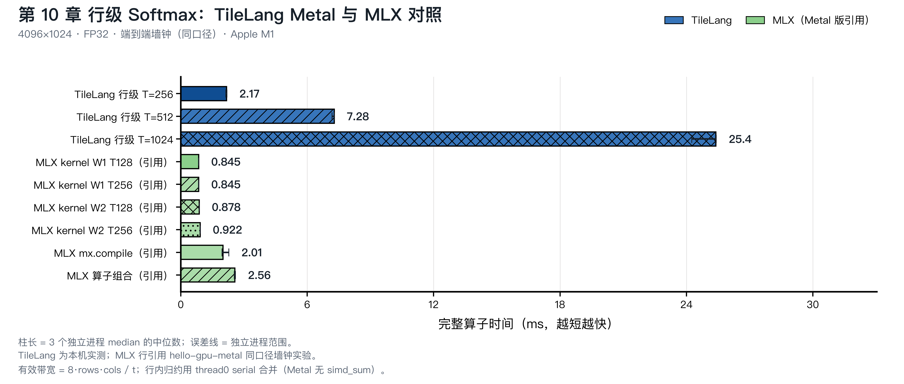

# 第10章 Normalization：行级 Softmax

## 本章导读

> Softmax 把「归约」与「逐元素」结合在同一行内：先求行最大值与指数和（两次归约），再逐元素归一化写回。数值稳定性要求**先减行最大值**再 exp，否则 ±1000 的平移输入会直接溢出。
>
> TileLang 路线让一个 threadgroup 负责一行，三次行内归约都用「每线程 serial 扫描 + thread0 serial 合并」。本章最重要的实测结论是：**threadgroup 宽度 T 不是越大越好**——T=1024 比 T=256 慢 11.7 倍。
>
> 计时为端到端墙钟；MLX 行引用 hello-gpu-metal 同口径实验。

## 10.1 Softmax 的数据依赖

### 10.1.1 行内全依赖、行间独立

$$
Y_{r,c} = \frac{\exp(X_{r,c} - m_r)}{\sum_{j} \exp(X_{r,j} - m_r)}, \qquad m_r = \max_j X_{r,j}
$$

第 r 行的每个输出依赖**整行**输入（通过 $m_r$ 与分母）；不同行互不依赖。因此自然分工是**一行一个 threadgroup**，行内再按列分线程。

### 10.1.2 三遍扫描的依赖链

1. **max 归约**：全行 → 标量 $m_r$（广播回所有线程）；
2. **exp 和归约**：全行 → 标量 $s_r$（广播）；
3. **逐元素写回**：每列独立，但需要 $m_r, s_r$。

遍与遍之间是**全行屏障**：第 2 遍必须等第 1 遍的广播完成。这决定了行内归约的合并方式直接决定总时间。

### 10.1.3 与第 9 章归约的区别

第 9 章归约成 1 个标量；本章归约成**每行 2 个标量**且要广播回行内所有线程，随后还有逐元素阶段。归约结果不再写回全局内存，而是留在 shared 里广播——省一次全局往返，但增加 shared 同步次数。

## 10.2 固定数学语义与正确性标准

### 10.2.1 四元素示例

```text
X = [1, 2, 3, 4]
m = 4;  exp(X-m) = [0.0498, 0.1353, 0.3679, 1.0]
s = 1.5530;  Y = [0.0321, 0.0871, 0.2369, 0.6439]
```

### 10.2.2 参考实现与检查条件

| 项目 | 固定方式 |
| ---- | ---- |
| 语义 | 稳定 Softmax（先减行最大值），FP32 |
| 输入 | shifted-dyadic：1/128 整数倍，按行 +1000 / −1000 / 0 平移 |
| 参考 | FP64 `exp(x - max)` 归一化 |
| 容差 | `abs <= 2e-5` 且 `row_sum 误差 <= 2e-5` |
| 边界 | (8,64), (32,128), (64,256), (128,512), (256,1024), (64,1025) × T∈{256,1024}（取 min(T,cols)）= 12 用例 |
| 计时 | 墙钟：预热 10、测量 50；4096×1024 |

±1000 平移是**稳定性测试**：直接 `exp(x)` 会溢出/下溢，必须先减最大值。若实现漏减，row_sum 检查会立刻失败。

### 10.2.3 非整除列宽与 threads 上限

`cols=1025` 时 `T=1024` 的最后一轮只有 1 个有效列，`if tid + j*threads < cols` 保护读写。**实测边界：Metal 后端在 `threads > cols` 时行内归约失效**（shared 合并读到未初始化槽位），因此边界脚本取 `eff = min(threads, cols)`，主实验固定 `cols=1024 >= T`。该限制写入 10.7。

## 10.3 建立成本模型和瓶颈假设

### 10.3.1 逻辑字节与三遍流量

| 遍 | 读 | 写 |
| ---- | ----: | ----: |
| max | 4RC | 0 |
| exp 和 | 4RC | 0 |
| 写回 | 4RC | 4RC |
| 合计 | 12RC | 4RC |

逻辑最小流量是 8RC（一读一写）；三遍扫描实际读 3 次，**16RC**。有效带宽按逻辑最小 8RC 折算：

$$
BW_{effective} = \frac{8 \cdot R \cdot C}{t}
$$

### 10.3.2 行内归约的串行成本

每次归约 = 每线程 serial 扫描 `ceil(C/T)` 个元素 + **thread0 serial 合并 T 个 shared 值**。三次归约 → 每行 `3·T` 次 serial 加法/最大值。T 从 256 → 1024 时该项 ×4，同时总线程数 ×4（4096 行 × T），M1 可驻留的 threadgroup 数下降。**假设：T 增大时串行合并与占用率双重恶化。**

## 10.4 实现行级 Softmax

**固定比较条件。** Apple M1、macOS 27.0、TileLang 0.1.15；4096×1024、FP32、shifted-dyadic、seed=20260920；预热 10、测量 50；3 进程轮换。

<ImplementationTabs id="ch10-implementations">

<template #tilelang>

### 10.4.1 TileLang 基线：T=256，一行一个 threadgroup

```python
with T.Kernel(rows, threads=threads) as bx:
    tid = T.get_thread_binding()
    lmax = T.alloc_fragment((1,), T.float32)
    lmax[0] = -1e30
    for j in T.serial(T.ceildiv(cols, threads)):
        if tid + j * threads < cols:
            lmax[0] = T.max(lmax[0], A[bx, tid + j * threads])
    s = T.alloc_shared((threads,), T.float32)
    s[tid] = lmax[0]
    T.sync_threads()
    if tid == 0:
        acc = T.alloc_fragment((1,), T.float32)
        acc[0] = -1e30
        for i in T.serial(threads):
            acc[0] = T.max(acc[0], s[i])
        s[0] = acc[0]
    T.sync_threads()
    mx = s[0]
```

exp 和与写回两遍结构相同。注意张量参数命名为 `A`/`B`：TileLang eager Metal 后端对其它名字的读取存在缺陷（见 10.7）。

<details>
<summary>完整源码：code/part2-kernels/chapter10/softmax_tilelang.py</summary>

<<< @/../code/part2-kernels/chapter10/softmax_tilelang.py{python}

</details>

<details>
<summary>共用输入与容差：code/part2-kernels/chapter10/softmax_common.py</summary>

<<< @/../code/part2-kernels/chapter10/softmax_common.py{python}

</details>

**运行与校验**

```bash
.venv/bin/python code/part2-kernels/chapter10/softmax_tilelang.py \
  --rows 4096 --cols 1024 --threads 256 \
  --warmup 10 --repeat 50 --seed 20260920
```

<details>
<summary>运行输出：tilelang-t256，第 1 个独立进程</summary>

<<< @/../code/part2-kernels/chapter10/evidence/metal-rounds/logs/n4096x1024-tilelang-t256-p1.log{text}

</details>

三进程中位数 **2.174980、2.186000、2.137521 ms**，图中取 **2.174980 ms**，范围 **2.137521–2.186000 ms**；`max_abs_error` 与 `max_row_sum_error` 均 < 2e-5。

### 10.4.2 threadgroup 宽度扫描：T=512 / 1024

只改 `--threads`。假设见 10.3.2：串行合并 ×T 与占用率下降双重恶化。

| 配置 | 中位数 (ms) | 进程范围 (ms) | 有效带宽 (GB/s) | 相对 T=256 |
| --- | ---: | --- | ---: | ---: |
| T=256 | 2.174980 | 2.137521–2.186000 | 15.43 | 1.00× |
| T=512 | 7.281625 | 7.181146–7.283479 | 4.61 | 3.35× 慢 |
| T=1024 | 25.397730 | 24.248250–25.415208 | 1.32 | 11.68× 慢 |

**强烈单调变慢**，且远超「serial 合并 ×4」的线性预期：T=1024 时每行 3×1024=3072 次 serial 操作，4096 行 × 1024 线程 = 4.19M 线程，M1 无法同时驻留，threadgroup 被串行化。决策：**保留 T=256**。

### 10.4.3 为什么 T=256 不是「越小越好」的反例

T=128 未在主实验扫描（边界脚本含 T=256/1024）。理论上 T 更小会进一步减少 serial 合并，但每线程串行扫描轮数 `ceil(1024/T)` 增加（T=128 → 8 轮），且 shared 广播次数不变。**本章不宣称 T=256 全局最优**，只宣称在 {256,512,1024} 中最优；更小 T 留作练习。

### 10.4.4 TileLang 路线的实验决策

| 改动 | 相对 T=256 | 决策 |
| --- | --- | --- |
| T=512 | +234.8% | 撤回 |
| T=1024 | +1067.7% | 撤回 |

本路线没有成功优化；基线即最优。负面结果本身是本章核心教学内容。

</template>

<template #mlx>

### 10.4.5 MLX 基线：算子组合与 mx.compile

MLX 路线先给两个框架级基线：算子组合（`max`/`exp`/`sum`/除法）与 `mx.compile` 融合。

<details>
<summary>完整参考源码：code/part2-kernels/chapter10/softmax_mlx.py</summary>

<<< @/../code/part2-kernels/chapter10/softmax_mlx.py{python}

</details>

> 数字引用 hello-gpu-metal 同口径墙钟实验；本仓库 `.venv` 未安装 mlx。

| 配置 | 中位数 (ms) | 进程范围 (ms) | 有效带宽 (GB/s) |
| --- | ---: | --- | ---: |
| 算子组合 | 2.562375 | 2.542750–2.593584 | 13.10 |
| mx.compile | 2.006834 | 1.959563–2.283833 | 16.72 |

`mx.compile` 把多遍算子融合成更少 dispatch，比组合快 21.7%。

### 10.4.6 自定义 metal_kernel：W 行 × T 线程 + simd 归约

`metal_kernel` 让一个 threadgroup 处理 W 行、每行 T 线程，行内用 `simd_max`/`simd_sum` + 两级 simd 合并（O(log) 硬件归约，替代 thread0 serial）：

| 配置 | 中位数 (ms) | 进程范围 (ms) | 有效带宽 (GB/s) |
| --- | ---: | --- | ---: |
| W=1, T=128 | 0.845042 | 0.844355–0.849396 | 39.71 |
| W=1, T=256 | 0.845042 | 0.841542–0.851209 | 39.71 |
| W=2, T=128 | 0.878396 | 0.875042–0.879126 | 38.20 |
| W=2, T=256 | 0.921625 | 0.914563–0.924999 | 36.41 |

W=1 与 T 无关（128/256 完全同值），W=2 反而变慢：一个 threadgroup 塞两行增加了 shared 与同步压力。**MLX 路线的最优是 W=1**，且对 T 不敏感——因为 simd 归约是 O(log)，不像 TileLang 的 O(T)。

### 10.4.7 MLX 路线的实验决策

保留 W=1·T=128（0.845042 ms）。与 TileLang T=256 比：**快 2.57 倍**，归因于硬件 simd 归约 + 更少的 shared 同步。

</template>

</ImplementationTabs>

## 10.5 正确性、基准测试与性能分析

### 10.5.1 从问题到字段

`RESULT` 行含 `max_abs_error` 与 `max_row_sum_error` 两个容差字段；`threadgroup=T`、`threads=rows×T`。row_sum 检查能抓住「漏减最大值」与「分母算错」两类错误。

### 10.5.2 边界正确性结果

12 个用例（6 形状 × 2 个 T，取 min(T,cols)）全部 `OK`，含 `cols=1025` 的非整除列宽与 ±1000 平移行。归档 `evidence/metal-rounds/boundary.json`。

### 10.5.3 Instruments 与 Xcode GPU Capture：官方工具，未在本机实测

要分离「serial 合并」与「占用率」两个因素，官方途径是 Xcode GPU Capture 看 T=1024 时的 resident threadgroup 数与 thread0 指令占比。**未在本机实测**；本章用 T 扫描的超线性恶化作间接证据，并明确这是假设而非证明。

## 10.6 两路线比较与验证

### 10.6.1 主输入汇总

::: figure fig-ch10-round-summary


4096×1024 · FP32 · 端到端墙钟。柱长为三进程 median 的中位数，误差线为进程范围；TileLang 为本机实测，MLX 行引用 hello-gpu-metal 同口径实验。
:::

@fig-ch10-round-summary 中 TileLang 的 T 扫描是本章最陡的负面曲线；MLX 的四个 kernel 配置几乎同高，说明 simd 归约下 T 不再是瓶颈。

| 路线 | 最快配置 | 中位数 (ms) | 有效带宽 (GB/s) |
| --- | --- | ---: | ---: |
| TileLang | T=256 | 2.174980 | 15.43 |
| MLX（引用） | W=1 · T=128 | 0.845042 | 39.71 |

### 10.6.2 其他规模验证

边界覆盖 8×64 → 256×1024。小行数（8 行）时 threadgroup 数太少、GPU 占用不足，墙钟会偏高；**不要**把 4096 行的 T 结论外推到 8 行。

### 10.6.3 尾部正确性

`cols=1025`、T=1024：最后一轮仅 1 列有效，guard 覆盖读写；12 用例全过。`threads>cols` 的失效边界由 `eff=min(T,cols)` 回避，而非修复。

## 10.7 负面结果、边界与下一步

**负面结果。**
1. T=512/1024 分别慢 3.35×/11.68×，超线性；thread0 serial 合并 O(T)×3 与占用率下降叠加。
2. W=2（MLX）比 W=1 慢 4–9%：一个 threadgroup 多行增加 shared/同步压力。
3. 三遍扫描读 3 次行数据（16RC 实际流量 vs 8RC 逻辑最小），**融合成单遍 online 归约**在第 12 章才展开；本章保留三遍作为正确基线。

**TileLang Metal 限制（实测）。**
- 无 `simd_sum`/`simd_max`/`tl.reduce` → 行内归约只能 thread0 serial，O(T)。
- **`threads > cols` 时行内归约失效**（shared 槽位未初始化），必须 `T <= cols`。
- eager Metal 后端仅张量参数名 `A`/`B` 读取可靠，其它名字存在缺陷。
- threadgroup 上限 1024 线程；T=1024 已触顶且实测最差。

**下一步。** 第 11 章换成二维分块的矩阵乘，看 `T.gemm` 与 tile 尺寸。

## 10.8 复现与练习

### 10.8.1 复现逐轮实验

```bash
.venv/bin/python code/part2-kernels/chapter10/run_rounds.py \
  --output code/part2-kernels/chapter10/evidence/my-run
```

只重绘图：

```bash
.venv/bin/python code/part2-kernels/chapter10/plot_rounds.py \
  --summary code/part2-kernels/chapter10/evidence/metal-rounds/summary/summary.csv \
  --out docs/part2-kernels/chapter10/images/round-summary
```

### 10.8.2 证据归档

`code/part2-kernels/chapter10/evidence/metal-rounds/`；MLX 引用行见 `chapter10/mlx_reference.json`。

### 10.8.3 练习

1. 手算 T=256、cols=1024 时每线程串行轮数与三次归约的 serial 合并总次数；再算 T=1024 的对应值，解释 11.68× 的来源假设。
2. 把 `--threads` 改成 128 重跑，判断是否比 256 更快；若更快，检查 `ceil(cols/T)` 轮数增加是否抵消了 serial 合并减少。
3. 构造一个漏减行最大值的实现，观察 `max_row_sum_error` 如何失败（±1000 行会溢出）。