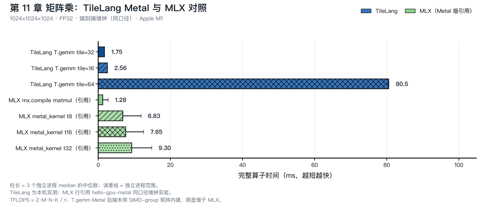

# 第11章 Matmul：分块矩阵乘

## 本章导读

> 矩阵乘是第一个**计算受限**的算子：$C = A B$ 的逻辑算术强度约 170 FLOP/Byte，瓶颈从内存供给转向算力与数据复用。分块（tiling）的目的不再是「减少启动开销」，而是**让 A/B 的 tile 在 shared 里被复用**。
>
> TileLang 的 `T.gemm` 在 Metal 后端**可用**（实测），但 lower 出的代码**没有使用 SIMD-group 矩阵内建**，因此明显慢于 MLX 的 `mx.compile`。本章最重要的负面结果是 **tile=64 比 tile=32 慢 46 倍**。
>
> 计时为端到端墙钟；MLX 行引用 hello-gpu-metal 同口径实验。

## 11.1 矩阵乘的数据依赖

### 11.1.1 一个输出依赖一行一列

$$
C_{i,j} = \sum_{k=0}^{K-1} A_{i,k} B_{k,j}
$$

$C_{i,j}$ 依赖 A 的第 i 行与 B 的第 j 列（K 个乘加）。不同输出之间独立，但**共享输入**：同一行的 C 输出复用 A 的同一行，同一列复用 B 的同一列。这是分块复用的来源。

### 11.1.2 二维分块与复用率

一个 threadgroup 计算 $BM \times BN$ 的 C tile，沿 K 以 BK 为步长累加。A tile 被 BN 列复用、B tile 被 BM 行复用：

$$
\text{reuse} = \frac{BM \cdot BN \cdot BK\ \text{FLOP}}{(BM \cdot BK + BK \cdot BN)\ \text{元素}}
$$

tile 越大复用率越高——**但 shared/寄存器预算也越大**。本章的 tile64 负面结果正是这个权衡的反面。

### 11.1.3 与归约的关系

沿 K 的累加是一次归约，但它在**寄存器/fragment 内**完成（`T.gemm` 累加到 `Cl`），不需要跨线程合并；跨 threadgroup 无依赖（每个 C tile 独立）。因此矩阵乘不需要第 9 章的两阶段结构。

## 11.2 固定数学语义与正确性标准

### 11.2.1 四元素示例

```text
A = [[1, 2], [3, 4]]   B = [[5, 6], [7, 8]]
C = [[19, 22], [43, 50]]
```

### 11.2.2 参考实现与检查条件

| 项目 | 固定方式 |
| ---- | ---- |
| 语义 | FP32 `C = A @ B`，行优先 |
| 输入 | dyadic：1/128 整数倍（FP32 精确） |
| 参考 | FP64 矩阵乘 |
| 容差 | 逐元素 Higham 上界：$\lvert err\rvert \le (\gamma_K + u)\,(\lvert A\rvert @ \lvert B\rvert)$，$\gamma_K = Ku/(1-Ku)$，$u=2^{-24}$ |
| 边界 | (64,64,64), (128,128,128), (256,256,256), (129,131,127) × tile∈{16,64} = 8 用例 |
| 计时 | 墙钟：预热 10、测量 50；1024×1024×1024 |

Higham 上界是**逐元素**的：不同位置的容差不同（取决于 $\lvert A\rvert @ \lvert B\rvert$ 的对应元素），比全局 atol 更紧也更公平。

### 11.2.3 非整除形状：主机补零

`T.gemm` 分块 kernel 要求 **M/N 为 tile 倍数、K 为 BK 倍数**，kernel 内不做边界 guard。非整除形状（如 129×131×127）由**主机补零**到对齐尺寸，再取左上 M×N 校验。补零不改变数学结果（零行/零列贡献 0），但增加了搬运量——这是本路线的边界代价，写入 11.7。

## 11.3 建立成本模型和瓶颈假设

### 11.3.1 逻辑 FLOP 与字节

| 项 | 数量 |
| ---- | ----: |
| FLOP | 2MNK |
| 读 A | 4MK |
| 读 B | 4KN |
| 写 C | 4MN |

1024³ 时：2.147 GFLOP，12.58 MB → $AI \approx 170.7$ FLOP/Byte。**计算受限**：优化目标是提高 FLOP/s，而不是带宽。

$$
\text{TFLOPS} = \frac{2MNK}{t \cdot 10^{9}}
$$

### 11.3.2 shared 预算与 tile 尺寸

每 threadgroup 的 shared：`As = tile×BK`、`Bs = BK×tile` 个 FP32；fragment `Cl = tile×tile` 分摊到 128 线程。

| tile | As+Bs (FP32) | Cl/线程 (FP32) |
| ---: | ---: | ---: |
| 16 | 1024 | 2 |
| 32 | 2048 | 8 |
| 64 | 4096 | 32 |

tile64 的 fragment 每线程 32 个 FP32 累加器 + shared 16 KB，**假设**接近 M1 的寄存器/shared 预算拐点，导致 lowering 退化或 spill。该假设未用 profiler 证明（见 11.5.3）。

## 11.4 实现分块矩阵乘

**固定比较条件。** Apple M1、macOS 27.0、TileLang 0.1.15；1024³、FP32、dyadic、seed=20260920；预热 10、测量 50；3 进程轮换；BK=32、threads=128 固定。

<ImplementationTabs id="ch11-implementations">

<template #tilelang>

### 11.4.1 TileLang 基线：tile=32 的 T.gemm 分块

```python
with T.Kernel(T.ceildiv(n, tile), T.ceildiv(m, tile), threads=THREADS) as (bx, by):
    As = T.alloc_shared((tile, BK), T.float32)
    Bs = T.alloc_shared((BK, tile), T.float32)
    Cl = T.alloc_fragment((tile, tile), T.float32)
    T.clear(Cl)
    for ko in T.serial(T.ceildiv(k, BK)):
        T.copy(A[by * tile, ko * BK], As)
        T.copy(B[ko * BK, bx * tile], Bs)
        T.gemm(As, Bs, Cl)
    T.copy(Cl, C[by * tile, bx * tile])
```

`T.copy` 搬入/写回，`T.gemm` 做 tile 内乘加。这是 TileLang 相对手写 MSL 的核心抽象：**你声明 tile 与累加，编译器负责 lower**。

<details>
<summary>完整源码：code/part2-kernels/chapter11/matmul_tilelang.py</summary>

<<< @/../code/part2-kernels/chapter11/matmul_tilelang.py{python}

</details>

<details>
<summary>共用输入与 Higham 上界：code/part2-kernels/chapter11/matmul_common.py</summary>

<<< @/../code/part2-kernels/chapter11/matmul_common.py{python}

</details>

**运行与校验**

```bash
.venv/bin/python code/part2-kernels/chapter11/matmul_tilelang.py \
  --m 1024 --n 1024 --k 1024 --tile 32 \
  --warmup 10 --repeat 50 --seed 20260920
```

<details>
<summary>运行输出：tilelang-tile32，第 1 个独立进程</summary>

<<< @/../code/part2-kernels/chapter11/evidence/metal-rounds/logs/n1024x1024x1024-tilelang-tile32-p1.log{text}

</details>

三进程中位数 **1.751208、1.735542、1.759583 ms**，图中取 **1.751208 ms**，范围 **1.735542–1.759583 ms**；`max_error_ratio <= 1`（Higham 上界内）。

### 11.4.2 tile 尺寸扫描：16 / 64

只改 `--tile`。假设：tile 越大复用率越高；但 shared/fragment 预算也越大。

| 配置 | 中位数 (ms) | 进程范围 (ms) | TFLOPS | 相对 tile32 |
| --- | ---: | --- | ---: | ---: |
| tile=16 | 2.555167 | 2.534146–2.562291 | 0.840 | 1.46× 慢 |
| tile=32 | 1.751208 | 1.735542–1.759583 | 1.226 | 1.00× |
| tile=64 | 80.540105 | 80.176541–80.626291 | 0.027 | **46.0× 慢** |

tile16 变慢符合「复用率下降 + threadgroup 数 ×4」的预期。**tile64 的 46 倍是本章核心负面结果**：三个进程一致（80.18–80.63 ms），不是噪声。决策：**保留 tile=32，撤回 tile=64**。

### 11.4.3 tile64 为什么慢：假设而非证明

候选解释：(a) fragment 每线程 32 个累加器 + 16 KB shared 触发 spill 或 lowering 退化；(b) `T.gemm` 对 64×64 tile 的 Metal lowering 走了串行路径。**没有 GPU 时间戳与 capture，无法区分**。本章只记录现象与候选假设，不宣称归因成立。

### 11.4.4 TileLang 路线的实验决策

| 改动 | 相对 tile32 | 决策 |
| --- | --- | --- |
| tile=16 | +45.9% | 撤回 |
| tile=64 | +4499% | 撤回，记录负面结果 |

</template>

<template #mlx>

### 11.4.5 MLX 基线：mx.compile 与 mx.matmul

MLX 路线的框架基线是 `mx.compile` 包裹的 matmul（底层走 Metal 的 SIMD-group 矩阵内建）。

<details>
<summary>完整参考源码：code/part2-kernels/chapter11/matmul_mlx.py</summary>

<<< @/../code/part2-kernels/chapter11/matmul_mlx.py{python}

</details>

> 数字引用 hello-gpu-metal 同口径墙钟实验；本仓库 `.venv` 未安装 mlx。

引用结果：`mlx-compile` 中位数 **1.279688 ms**（范围 1.234396–2.774521），**1.678 TFLOPS**。注意其进程范围上界 2.77 ms 是下界 1.23 ms 的 2.2 倍——框架路径受后台争用影响更大，引用时保留全范围。

### 11.4.6 自定义 metal_kernel：T×T tile 逐元素累加

`metal_kernel` 每 threadgroup 算一个 T×T 的 C tile，每线程沿 K 串行累加（**无 shared 复用**，作为教学对照）：

| 配置 | 中位数 (ms) | 进程范围 (ms) | TFLOPS |
| --- | ---: | --- | ---: |
| t8 | 6.832437 | 6.755333–11.886854 | 0.314 |
| t16 | 7.652083 | 7.646271–12.567729 | 0.281 |
| t32 | 9.297667 | 9.226041–14.857813 | 0.231 |

无 shared 复用的朴素 kernel 比 `mx.compile` 慢 5–7 倍，且 tile 越大越慢（每线程串行 K 轮、无复用）。**这组对照说明：矩阵乘的收益来自复用与硬件矩阵内建，而不是 tile 本身。**

### 11.4.7 MLX 路线的实验决策

保留 `mx.compile`（1.279688 ms）。与 TileLang tile32 比：**快 1.37 倍**；与 TileLang tile64 比：快 63 倍。差距的主因是 Metal SIMD-group 矩阵内建 vs `T.gemm` 的通用 lowering。

</template>

</ImplementationTabs>

## 11.5 正确性、基准测试与性能分析

### 11.5.1 从问题到字段

`RESULT` 行含 `max_abs_error` 与 `max_error_ratio`（Higham 上界的最大占用比，<=1 才正确）；`block=tile`、`threadgroup=128`、`threads=0`（tile 调度不报总线程数）。

### 11.5.2 边界正确性结果

8 个用例（4 形状 × 2 tile）全部 `OK`，含非整除 129×131×127（主机补零到 16/64 与 BK=32 的倍数）。归档 `evidence/metal-rounds/boundary.json`。

### 11.5.3 Instruments 与 Xcode GPU Capture：官方工具，未在本机实测

tile64 的 46 倍 slowdown 需要 capture 看 shared 占用、spill 与指令数才能归因。**未在本机实测**；11.4.3 的两个候选解释保持为假设。这是本章「负面结果边界」的一部分：我们记录了现象，但承认归因证据不足。

## 11.6 两路线比较与验证

### 11.6.1 主输入汇总

::: figure fig-ch11-round-summary


<details class="figure-zoom">
<summary>放大图表（可横向滚动）</summary>
<div class="figure-scroll" tabindex="0" role="region" aria-label="第 11 章逐轮比较放大图，可横向滚动">



</div>
</details>

1024×1024×1024 · FP32 · 端到端墙钟。柱长为三进程 median 的中位数，误差线为进程范围；TileLang 为本机实测，MLX 行引用 hello-gpu-metal 同口径实验。
:::

@fig-ch11-round-summary 中 tile64 的柱几乎顶到坐标轴上限（80.5 ms），与其余配置不在一个量级；读图时注意它是**负面结果**而非基线。

| 路线 | 最快配置 | 中位数 (ms) | TFLOPS |
| --- | --- | ---: | ---: |
| TileLang | tile=32 | 1.751208 | 1.226 |
| MLX（引用） | mx.compile | 1.279688 | 1.678 |

### 11.6.2 其他规模验证

边界覆盖 64³ → 256³ 与非整除 129×131×127。小矩阵下 threadgroup 数不足（64³/tile32 = 2×2 = 4 个），GPU 占用极低，墙钟 dominated by 启动；**不要**外推 1024³ 的 tile 结论到 64³。

### 11.6.3 尾部正确性

非整除形状靠主机补零保证：补零行/列贡献 0，左上 M×N 与参考一致。8 用例全过说明补零语义正确；但**补零增加了搬运量**，小矩阵下代价占比更高。

## 11.7 负面结果、边界与下一步

**负面结果。**
1. **tile=64 慢 46 倍**（80.54 vs 1.75 ms），三进程一致；归因未证明，候选解释见 11.4.3。
2. tile=16 慢 46%：复用率下降 + threadgroup 数 ×4。
3. MLX 朴素 metal_kernel（无 shared 复用）比 mx.compile 慢 5–7 倍：tile 本身不带来收益。

**TileLang Metal 限制（实测）。**
- `T.gemm` 可用但**未用 SIMD-group 矩阵内建**，FP32 吞吐明显低于 MLX 框架路径。
- `T.gemm` 要求 M/N 为 tile 倍数、K 为 BK 倍数；**kernel 内无边界 guard**，非整除形状必须主机补零。
- shared/fragment 预算拐点未剖明；tile64 的退化是当前 lowering 的边界，不是数学错误。
- threadgroup 固定 128 线程；tile64 时每线程 32 个累加器。

**下一步。** 第 12 章把矩阵乘的「复用」思想用到 Attention：在线融合消除 scores 物化。

## 11.8 复现与练习

### 11.8.1 复现逐轮实验

```bash
.venv/bin/python code/part2-kernels/chapter11/run_rounds.py \
  --output code/part2-kernels/chapter11/evidence/my-run
```

只重绘图：

```bash
.venv/bin/python code/part2-kernels/chapter11/plot_rounds.py \
  --summary code/part2-kernels/chapter11/evidence/metal-rounds/summary/summary.csv \
  --out docs/part2-kernels/chapter11/images/round-summary
```

### 11.8.2 证据归档

`code/part2-kernels/chapter11/evidence/metal-rounds/`；MLX 引用行见 `chapter11/mlx_reference.json`。

### 11.8.3 练习

1. 手算 1024³ 的 AI（FLOP/Byte），并说明为什么它属于计算受限而非访存受限。
2. 用 Higham 上界估算 K=1024、u=2^-24 时 $\gamma_K$ 的量级，解释为什么容差比 atol=1e-6 宽。
3. 把 BK 从 32 改成 16（tile=32 固定），预测 shared 流量与复用率的变化并实测；注意 K 必须仍为 BK 倍数。