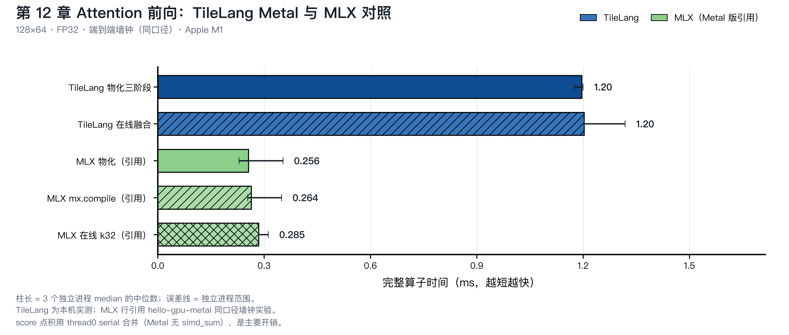

# 第12章 Fusion：Attention 前向

## 本章导读

> Attention 前向 = 两次矩阵乘夹一个行级 Softmax：$O = \mathrm{softmax}(QK^\top/\sqrt{d})\,V$。FlashAttention 的核心是**在线 softmax**：逐 key 更新 $(m, l, acc)$，不物化 $S = QK^\top$。
>
> 本章在 128×64 的教学规模上比较两条 TileLang 路线：**online**（逐 key 重缩放）与 **materialized**（先算整行 scores 再 softmax 加权）。实测两者**几乎同速**（1.203 vs 1.196 ms）——在本 shape 下融合没有带来收益，原因与边界写入 12.7。
>
> 计时为端到端墙钟；MLX 行引用 hello-gpu-metal 同口径实验。

## 12.1 Attention 的数据依赖

### 12.1.1 一个 query 行依赖全部 key

$$
O_{i,:} = \sum_{j} \frac{\exp(q_i \cdot k_j / \sqrt{d} - m_i)}{l_i}\, v_j
$$

第 i 行输出依赖**所有** key/value（通过 softmax 分母），行与行独立。自然分工：一行一个 threadgroup，组内 dim 个线程各持一个分量。

### 12.1.2 在线状态的转移

online 路线维护三个标量/向量状态： running max $m$、running sum $l$、running 加权和 $acc$。每来一个 key：

$$
m' = \max(m, s_j),\quad corr = e^{m - m'},\quad l' = l \cdot corr + e^{s_j - m'},\quad acc' = acc \cdot corr + e^{s_j - m'} v_j
$$

**重缩放**（乘 $corr$）是在线路线的额外代价：materialized 只需一次 exp/element，online 需要两次 exp + 一次乘 per key。

### 12.1.3 物化路线的中间数组

materialized 先把整行 scores 写进 **shared**（seq 个 FP32），再做行 max、exp 和、加权求和。注意：本 TileLang 两版都**不写全局 scores**，「物化」发生在 shared 内；因此「消除全局物化」这一 FlashAttention 主要收益在本实现中**本来就不存在**，这是 12.7 的关键边界。

## 12.2 固定数学语义与正确性标准

### 12.2.1 四元素示例

```text
q = [1, 0], k = [[1, 0], [0, 1]], v = [[1, 2], [3, 4]], d = 2
scores = [1/√2, 0];  softmax ≈ [0.6225, 0.3775]
O ≈ [0.6225*1 + 0.3775*3, 0.6225*2 + 0.3775*4] = [1.755, 2.755]
```

### 12.2.2 参考实现与检查条件

| 项目 | 固定方式 |
| ---- | ---- |
| 语义 | FP32 稳定 softmax 注意力，$1/\sqrt{d}$ 缩放 |
| 输入 | dyadic（1/64 或 1/32 整数倍）；另加 `rising-max`（scores 单调增，压在线重缩放） |
| 参考 | FP64 `softmax(QK^T/√d) V` |
| 容差 | 逐元素 `abs <= 2e-5 + 2e-4·|ref|` |
| 边界 | (128,64), (64,64), (256,64), (32,32) × {online, materialized} × {dyadic, rising-max} = 16 用例 |
| 计时 | 墙钟：预热 10、测量 50；128×64 |

`rising-max` 输入让 $m$ 每步都更新，**最大化重缩放次数**，是在线路线数值稳定性的压力测试。

### 12.2.3 打包张量与命名边界

Q/K/V 打包进 `A[3, seq, dim]`、输出 `B[seq, dim]`：TileLang eager Metal 后端仅 `A`/`B` 名读取可靠（同第 10 章）。打包不改变数学，只改变访存布局（三个矩阵连续）。

## 12.3 建立成本模型和瓶颈假设

### 12.3.1 逻辑 FLOP 与字节

| 项 | 数量（seq=S, dim=D） |
| ---- | ----: |
| scores | 2S²D |
| softmax | ~5S² |
| 加权 V | 2S²D |
| 读 Q/K/V | 12SD |
| 写 O | 4SD |

128×64 时 FLOP ≈ 4.2M，字节 ≈ 100 KB → AI ≈ 42 FLOP/Byte，**介于访存与计算之间**；但 S=128 太小，threadgroup 只有 128 个、每个 64 线程，GPU 占用不足，**启动与同步开销主导**。

### 12.3.2 两路线的额外操作计数

| 操作 | online | materialized |
| ---- | ---: | ---: |
| exp / key / 行 | 2S | S |
| 重缩放乘 / key / 行 | 2S | 0 |
| shared scores 写 | 0 | S |
| 行内归约次数 | 0（状态在寄存器） | 2（max、sum） |

online 省掉 shared scores 与两次行内归约，但 exp 与乘翻倍。**假设：S 小时两者打平；S 大时 online 省全局/shared 流量才显收益。**

## 12.4 实现 Attention 前向

**固定比较条件。** Apple M1、macOS 27.0、TileLang 0.1.15；128×64、FP32、dyadic、seed=20260920；预热 10、测量 50；3 进程轮换。

<ImplementationTabs id="ch12-implementations">

<template #tilelang>

### 12.4.1 TileLang online：逐 key 更新 (m, l, acc)

```python
for j in T.serial(seq):
    s[tid] = qf[0] * A[1, j, tid]
    T.sync_threads()
    if tid == 0:
        a = T.alloc_fragment((1,), T.float32)
        T.clear(a)
        for d in T.serial(dim):
            a[0] = a[0] + s[d]
        s[0] = a[0]
    T.sync_threads()
    score = s[0] * inv_sqrt
    m_new = T.max(m[0], score)
    corr = T.exp(m[0] - m_new)
    p = T.exp(score - m_new)
    l[0] = l[0] * corr + p
    acc[0] = acc[0] * corr + p * A[2, j, tid]
    m[0] = m_new
B[bx, tid] = acc[0] / l[0]
```

score 的点积用「每线程乘积 + thread0 serial 合并 dim 个 shared 值」（Metal 无 `simd_sum`）。**每个 key 一次 threadgroup 屏障 ×2**，S=128 → 256 次屏障/行，这是 online 路线的主要开销。

<details>
<summary>完整源码：code/part2-kernels/chapter12/attention_tilelang.py</summary>

<<< @/../code/part2-kernels/chapter12/attention_tilelang.py{python}

</details>

<details>
<summary>共用输入与混合容差：code/part2-kernels/chapter12/attention_common.py</summary>

<<< @/../code/part2-kernels/chapter12/attention_common.py{python}

</details>

**运行与校验**

```bash
.venv/bin/python code/part2-kernels/chapter12/attention_tilelang.py \
  --version online --seq 128 --dim 64 \
  --warmup 10 --repeat 50 --seed 20260920
```

<details>
<summary>运行输出：tilelang-online，第 1 个独立进程</summary>

<<< @/../code/part2-kernels/chapter12/evidence/metal-rounds/logs/n128x64-tilelang-online-p1.log{text}

</details>

三进程中位数 **1.202396、1.318459、1.203063 ms**，图中取 **1.203063 ms**，范围 **1.202396–1.318459 ms**（第 2 进程一次抖动保留在范围内）。

### 12.4.2 TileLang materialized：shared scores 三阶段

先整行 scores 写 shared，再行 max（thread0 serial）、exp 和（每线程一段 + thread0 合并）、加权求和。行 max 用**独立 shared 单元 `mb` 广播**，避免覆盖 `scores[0]`——这是一个实测踩过的坑：复用 `s[0]` 会破坏 scores。

实测三进程中位数 **1.196354、1.199875、1.175042 ms**，图中取 **1.196354 ms**，范围 **1.175042–1.199875 ms**。

### 12.4.3 online vs materialized：0.6% 的差异

| 配置 | 中位数 (ms) | 进程范围 (ms) |
| --- | ---: | --- |
| materialized | 1.196354 | 1.175042–1.199875 |
| online | 1.203063 | 1.202396–1.318459 |

差异 0.0067 ms（0.56%）。两范围**不相交**（materialized 上界 1.1999 < online 下界 1.2024），故 online 略慢是稳定的，但量级极小。**结论：在本 shape 下在线融合没有收益**——scores 只在 shared、物化代价小，而 online 的 exp/重缩放翻倍 + 每 key 双屏障抵消了省下的归约。

### 12.4.4 TileLang 路线的实验决策

保留 materialized 作为基线（略快且屏障更少）；online 保留为**教学对照**（展示 FlashAttention 状态转移），不宣称性能优势。

</template>

<template #mlx>

### 12.4.5 MLX 基线：物化算子组合与 mx.compile

MLX 路线先给框架基线：物化算子组合（`matmul` → `softmax` → `matmul`）与 `mx.compile`。

<details>
<summary>完整参考源码：code/part2-kernels/chapter12/attention_mlx.py</summary>

<<< @/../code/part2-kernels/chapter12/attention_mlx.py{python}

</details>

> 数字引用 hello-gpu-metal 同口径墙钟实验；本仓库 `.venv` 未安装 mlx。

| 配置 | 中位数 (ms) | 进程范围 (ms) |
| --- | ---: | --- |
| 物化算子组合 | 0.256062 | 0.228938–0.353354 |
| mx.compile | 0.263999 | 0.253709–0.349291 |

`mx.compile` 在本 shape **没有**比组合快（+3.1%，范围重叠）：S=128 太小，融合省下的 dispatch 开销不足以抵消编译路径的额外开销。

### 12.4.6 自定义 metal_kernel：在线 k32

`metal_kernel` 每 threadgroup 一个 query 行，逐 key tile（k=32）更新 (m, l, acc)，score 点积由每线程串行 dim 轮完成（**无 shared 归约**，每线程自己算完整点积）：

引用结果：`mlx-online-k32` 中位数 **0.284938 ms**（范围 0.284375–0.311666），比物化组合慢 11.3%。**MLX 路线同样观察到在线融合在本 shape 无收益**，与 TileLang 同向。

### 12.4.7 MLX 路线的实验决策

保留物化组合（0.256062 ms）。与 TileLang materialized 比：**快 4.67 倍**；差距主因是 MLX 的 score 点积不需要 thread0 serial 合并 + 每 key 双屏障。

</template>

</ImplementationTabs>

## 12.5 正确性、基准测试与性能分析

### 12.5.1 从问题到字段

`RESULT` 行含 `max_abs_error` 与 `max_tolerance_ratio`（混合容差占用比，<=1 才正确）。本章 summary **不含带宽/TFLOPS 列**：S=128 太小，折算带宽无意义，只比墙钟。

### 12.5.2 边界正确性结果

16 个用例（4 形状 × 2 版本 × 2 输入）全部 `OK`，含 `rising-max`（在线重缩放压力测试）与 32×32 小形状。归档 `evidence/metal-rounds/boundary.json`。

### 12.5.3 Instruments 与 Xcode GPU Capture：官方工具，未在本机实测

要验证「每 key 双屏障是 online 的主要开销」，官方途径是 capture 看 barrier 等待占比。**未在本机实测**；本章用操作计数（12.3.2）与两路线同向的实测差值作间接证据。

## 12.6 两路线比较与验证

### 12.6.1 主输入汇总

::: figure fig-ch12-round-summary


128×64 · FP32 · 端到端墙钟。柱长为三进程 median 的中位数，误差线为进程范围；TileLang 为本机实测，MLX 行引用 hello-gpu-metal 同口径实验。
:::

@fig-ch12-round-summary 中 TileLang 两柱几乎同高（1.196 / 1.203 ms），MLX 三柱也几乎同高（0.256–0.285 ms）：**两条路线、四种实现都指向「本 shape 下融合无收益」**。

| 路线 | 最快配置 | 中位数 (ms) |
| --- | --- | ---: |
| TileLang | materialized | 1.196354 |
| MLX（引用） | 物化算子组合 | 0.256062 |

### 12.6.2 其他规模验证

边界覆盖 32×32 → 256×64。S=256 时 online 的屏障数翻倍（512/行），预期差距拉大；**主实验只测 128×64**，更大 S 的融合收益留作练习（12.8.3）。

### 12.6.3 尾部正确性

`rising-max` 让每步 $m$ 都更新，检验 $corr = e^{m-m'}$ 的数值稳定性；16 用例全过说明在线重缩放没有累积误差超出混合容差。

## 12.7 负面结果、边界与下一步

**负面结果。**
1. **在线融合在本 shape 无收益**：TileLang online 比 materialized 慢 0.56%（稳定但极小）；MLX online-k32 比物化慢 11.3%。两条路线同向。
2. `mx.compile` 在本 shape 不比算子组合快（+3.1%，范围重叠）：S 太小，融合省下的 dispatch 不足以抵消开销。
3. online 的 exp/重缩放翻倍 + 每 key 双屏障，抵消了省下的 shared scores 与行内归约。

**TileLang Metal 限制（实测）。**
- 无 `simd_sum` → score 点积只能 thread0 serial 合并 dim 个 shared 值，每 key 两次屏障。
- 仅 `A`/`B` 张量名读取可靠 → Q/K/V 必须打包进 `A[3,seq,dim]`。
- 本实现两版都不写全局 scores，**「消除全局物化」的收益不可测**；要测它需要 S 大到 shared 放不下（S>1024 量级），超出本章教学规模。
- threadgroup = dim = 64 线程；S=128 → 128 个 threadgroup，GPU 占用不足。

**下一步。** 第 13 章把归约 + 逐元素融合收束成 Fused RMSNorm，做全篇方法总结。

## 12.8 复现与练习

### 12.8.1 复现逐轮实验

```bash
.venv/bin/python code/part2-kernels/chapter12/run_rounds.py \
  --output code/part2-kernels/chapter12/evidence/my-run
```

只重绘图：

```bash
.venv/bin/python code/part2-kernels/chapter12/plot_rounds.py \
  --summary code/part2-kernels/chapter12/evidence/metal-rounds/summary/summary.csv \
  --out docs/part2-kernels/chapter12/images/round-summary
```

### 12.8.2 证据归档

`code/part2-kernels/chapter12/evidence/metal-rounds/`；MLX 引用行见 `chapter12/mlx_reference.json`。

### 12.8.3 练习

1. 手算 S=128、D=64 时 online 路线每行的屏障次数与 exp 次数，对照 materialized 的对应值。
2. 把 `--seq` 改成 512 重跑两版，判断 online 与 materialized 的差距是否拉大；若拉大，用 12.3.2 的操作计数解释。
3. 构造一个漏乘 `corr` 的 online 实现，用 `rising-max` 输入观察 `max_tolerance_ratio` 如何失败。