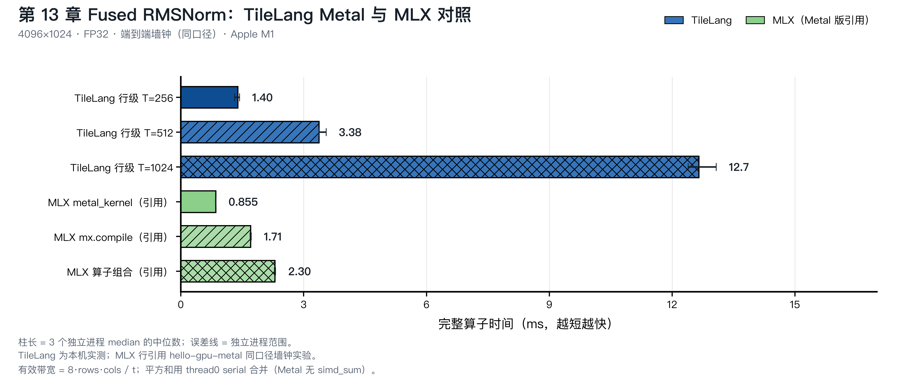

# 第13章 Fused RMSNorm：综合实战

## 本章导读

> RMSNorm 把第 9 章的**归约**（行内平方和）与第 8 章的**逐元素**（rsqrt 缩放 × 权重）融合在一个 kernel 里：
>
> $$Y_{r,c} = \frac{X_{r,c}}{\sqrt{\frac{1}{C}\sum_j X_{r,j}^2 + \epsilon}} \cdot W_c$$
>
> 它是全篇方法的收束：数据依赖（行内全依赖）、正确性（混合容差 + zero/signed-weight 边界）、成本模型（两遍流量）、双路线、T 扫描的负面结果，一次用齐。
>
> 实测结论与第 10 章同向：**T=256 最快，T=1024 慢 9.1 倍**；MLX 的 `metal_kernel`（simd 归约）比 TileLang 最快配置再快 1.63 倍。计时为端到端墙钟；MLX 行引用 hello-gpu-metal 同口径实验。

## 13.1 RMSNorm 的数据依赖

### 13.1.1 行内归约 + 逐元素写回

第 r 行的每个输出依赖**整行平方和**（一个标量），随后逐元素乘 $W_c$。与 Softmax 相比少一次归约（无 max、无 exp 和），与第 9 章相比归约结果要**广播回行内**并接逐元素阶段。

### 13.1.2 两遍结构

1. **平方和归约**：每线程 serial 累加 `ceil(C/T)` 个 $x^2$ → shared → thread0 serial 合并 T 个 → 广播 $inv\_rms$；
2. **逐元素写回**：$y = x \cdot inv\_rms \cdot w$，每列独立。

遍间一次全行屏障。归约的合并方式（O(T) serial）再次成为 T 扫描的主导因素。

### 13.1.3 与 LayerNorm 的区别

RMSNorm **不减均值**，只除均方根：少一次归约、少一次读。$\epsilon$ 加在均值平方**内部**（$\sqrt{mean(x^2)+\epsilon}$），位置写错会改变 zero 输入的语义——13.2 的 zero 边界专门抓这个。

## 13.2 固定数学语义与正确性标准

### 13.2.1 四元素示例

```text
X = [1, 2, 3, 4], W = [1, 1, 1, 1], eps = 1e-5
mean(x^2) = 30/4 = 7.5;  inv_rms = 1/sqrt(7.5+1e-5) ≈ 0.36515
Y ≈ [0.36515, 0.73030, 1.09545, 1.46060]
```

### 13.2.2 参考实现与检查条件

| 项目 | 固定方式 |
| ---- | ---- |
| 语义 | FP32 `y = x * rsqrt(mean(x^2)+eps) * w`，eps=1e-5 |
| 输入 | dyadic（1/128 整数倍）；边界另加 `zero`、`zero-weight`、`signed-weight` |
| 参考 | FP64 同公式 |
| 容差 | 逐元素 `abs <= 2e-5 + 2e-5·\|ref\|` |
| 边界 | (8,64), (64,256), (256,1024), (64,1025) × T∈{256,1024}(取 min) × 3 输入模式 = 24 用例 |
| 计时 | 墙钟：预热 10、测量 50；4096×1024 |

`zero` 输入检验 $\epsilon$ 位置：若漏加 eps，`rsqrt(0)` 产生 inf；`signed-weight` 检验权重符号不被平方吞掉。

### 13.2.3 非整除列宽与 threads 上限

`cols=1025`、T=1024 时最后一轮 1 列有效，guard 覆盖读写。同第 10 章：**Metal 后端 `threads > cols` 时行内归约失效**，边界取 `eff=min(T,cols)`，主实验 `cols=1024 >= T`。

## 13.3 建立成本模型和瓶颈假设

### 13.3.1 逻辑字节与两遍流量

| 遍 | 读 | 写 |
| ---- | ----: | ----: |
| 平方和 | 4RC | 0 |
| 写回 | 4RC + 4C（w） | 4RC |
| 合计 | 8RC + 4C | 4RC |

逻辑最小 8RC（一读一写，w 忽略）；两遍实际读 x 两次 → 12RC + 4C。有效带宽按 8RC 折算：

$$
BW_{effective} = \frac{8 \cdot R \cdot C}{t}
$$

### 13.3.2 归约的串行成本（与第 10 章同构）

每行一次归约 = 每线程 serial `ceil(C/T)` + **thread0 serial 合并 T 个**。T: 256→1024 时该项 ×4，总线程数 ×4（4096×T）。**假设：与第 10 章同向的超线性恶化**；本章用实测检验该假设是否跨算子成立。

## 13.4 实现 Fused RMSNorm

**固定比较条件。** Apple M1、macOS 27.0、TileLang 0.1.15；4096×1024、FP32、dyadic、seed=20260920；预热 10、测量 50；3 进程轮换。

<ImplementationTabs id="ch13-implementations">

<template #tilelang>

### 13.4.1 TileLang 基线：T=256，一行一个 threadgroup

```python
with T.Kernel(rows, threads=threads) as bx:
    tid = T.get_thread_binding()
    lsum = T.alloc_fragment((1,), T.float32)
    T.clear(lsum)
    for j in T.serial(T.ceildiv(cols, threads)):
        if tid + j * threads < cols:
            xv = A[bx, tid + j * threads]
            lsum[0] = lsum[0] + xv * xv
    s = T.alloc_shared((threads,), T.float32)
    s[tid] = lsum[0]
    T.sync_threads()
    if tid == 0:
        acc = T.alloc_fragment((1,), T.float32)
        T.clear(acc)
        for i in T.serial(threads):
            acc[0] = acc[0] + s[i]
        s[0] = acc[0]
    T.sync_threads()
    inv_rms = T.rsqrt(s[0] / cols + epsilon)
    for j in T.serial(T.ceildiv(cols, threads)):
        if tid + j * threads < cols:
            C[bx, tid + j * threads] = A[bx, tid + j * threads] * inv_rms * B[tid + j * threads]
```

张量名 `A=x`、`B=weight`、`C=out`（eager Metal 仅 A/B 读取可靠，C 为输出名可用）。`T.rsqrt` 在 Metal 后端可用。

<details>
<summary>完整源码：code/part2-kernels/chapter13/rmsnorm_tilelang.py</summary>

<<< @/../code/part2-kernels/chapter13/rmsnorm_tilelang.py{python}

</details>

<details>
<summary>共用输入与混合容差：code/part2-kernels/chapter13/rmsnorm_common.py</summary>

<<< @/../code/part2-kernels/chapter13/rmsnorm_common.py{python}

</details>

**运行与校验**

```bash
.venv/bin/python code/part2-kernels/chapter13/rmsnorm_tilelang.py \
  --rows 4096 --cols 1024 --threads 256 \
  --warmup 10 --repeat 50 --seed 20260920
```

<details>
<summary>运行输出：tilelang-t256，第 1 个独立进程</summary>

<<< @/../code/part2-kernels/chapter13/evidence/metal-rounds/logs/n4096x1024-tilelang-t256-p1.log{text}

</details>

三进程中位数 **1.395291、1.433791、1.316021 ms**，图中取 **1.395291 ms**，范围 **1.316021–1.433791 ms**；`max_abs_error=2.38e-07`，远小于容差。

### 13.4.2 threadgroup 宽度扫描：T=512 / 1024

只改 `--threads`，检验 13.3.2 的跨算子假设。

| 配置 | 中位数 (ms) | 进程范围 (ms) | 有效带宽 (GB/s) | 相对 T=256 |
| --- | ---: | --- | ---: | ---: |
| T=256 | 1.395291 | 1.316021–1.433791 | 24.05 | 1.00× |
| T=512 | 3.376875 | 3.369938–3.550791 | 9.94 | 2.42× 慢 |
| T=1024 | 12.653688 | 12.390729–13.076563 | 2.65 | 9.07× 慢 |

**假设成立**：与第 10 章 Softmax 同向的超线性恶化（Softmax 11.68×、RMSNorm 9.07×；RMSNorm 少两次归约，故倍数略小）。决策：**保留 T=256**。

### 13.4.3 融合 vs 分拆：本章不做分拆对照

「融合」的收益需要与「平方和 kernel + 缩放 kernel」两 dispatch 对照才能量化。本章**未跑该对照**（主实验只扫 T），因此不宣称融合收益；第 10 章的三遍 vs 单遍讨论已说明融合省的是全局往返。该对照留作练习（13.8.3）。

### 13.4.4 TileLang 路线的实验决策

| 改动 | 相对 T=256 | 决策 |
| --- | --- | --- |
| T=512 | +142.0% | 撤回 |
| T=1024 | +806.9% | 撤回 |

基线即最优；与第 10 章一起构成「行内归约算子不要加宽 threadgroup」的跨算子结论。

</template>

<template #mlx>

### 13.4.5 MLX 基线：算子组合与 mx.compile

MLX 框架基线：算子组合（`mean(x*x)` → `rsqrt` → 乘 w）与 `mx.compile`。

<details>
<summary>完整参考源码：code/part2-kernels/chapter13/rmsnorm_mlx.py</summary>

<<< @/../code/part2-kernels/chapter13/rmsnorm_mlx.py{python}

</details>

> 数字引用 hello-gpu-metal 同口径墙钟实验；本仓库 `.venv` 未安装 mlx。

| 配置 | 中位数 (ms) | 进程范围 (ms) | 有效带宽 (GB/s) |
| --- | ---: | --- | ---: |
| 算子组合 | 2.299584 | 2.285520–2.315791 | 14.59 |
| mx.compile | 1.705583 | 1.691500–1.718854 | 19.67 |

`mx.compile` 比组合快 25.8%：两遍算子融合成更少 dispatch，且范围不重叠（稳定收益）。

### 13.4.6 自定义 metal_kernel：simd_sum 平方和

`metal_kernel` 一行一个 threadgroup，`simd_sum` + 两级 simd 合并求平方和（O(log)），再 rsqrt 缩放乘 w：

引用结果：`mlx-kernel` 中位数 **0.855063 ms**（范围 0.847208–0.860063），**39.24 GB/s**。比 `mx.compile` 快 1.99 倍、比 TileLang T=256 快 1.63 倍。

### 13.4.7 MLX 路线的实验决策

保留 `metal_kernel`（0.855063 ms）。与 TileLang 的差距再次归因于硬件 simd 归约替代 thread0 serial 合并——**第 9、10、13 章三处同向证据**。

</template>

</ImplementationTabs>

## 13.5 正确性、基准测试与性能分析

### 13.5.1 从问题到字段

`RESULT` 行含 `max_abs_error` 与 `max_rel_error`；`threadgroup=T`、`threads=rows×T`、`effective_bandwidth_gbs=8RC/t`。

### 13.5.2 边界正确性结果

24 个用例（4 形状 × 2 T × 3 输入模式）全部 `OK`，含 `zero`（eps 位置）、`signed-weight`（符号）、`cols=1025`（尾部）。归档 `evidence/metal-rounds/boundary.json`。

### 13.5.3 Instruments 与 Xcode GPU Capture：官方工具，未在本机实测

T=1024 的 9.07× 恶化需要 capture 分离 serial 合并与占用率。**未在本机实测**；本章以第 10 章同构扫描作跨算子间接证据，并保留为假设。

## 13.6 两路线比较与验证

### 13.6.1 主输入汇总

::: figure fig-ch13-round-summary


<details class="figure-zoom">
<summary>放大图表（可横向滚动）</summary>
<div class="figure-scroll" tabindex="0" role="region" aria-label="第 13 章逐轮比较放大图，可横向滚动">


</div>
</details>

4096×1024 · FP32 · 端到端墙钟。柱长为三进程 median 的中位数，误差线为进程范围；TileLang 为本机实测，MLX 行引用 hello-gpu-metal 同口径实验。
:::

@fig-ch13-round-summary 中 TileLang 的 T 扫描与第 10 章形状一致；MLX 三配置单调（kernel < compile < compose），说明融合与硬件归约各自贡献可分离。

| 路线 | 最快配置 | 中位数 (ms) | 有效带宽 (GB/s) |
| --- | --- | ---: | ---: |
| TileLang | T=256 | 1.395291 | 24.05 |
| MLX（引用） | metal_kernel | 0.855063 | 39.24 |

### 13.6.2 全篇收束：六章最快配置一览

| 章 | 算子 | TileLang 最快 (ms) | MLX 最快 (ms, 引用) | 比值 |
| --- | --- | ---: | ---: | ---: |
| 8 | Vector Add | 3.638437 | 3.676229 | 0.99× |
| 9 | Sum Reduction | 0.489563 | 0.285208 | 1.72× |
| 10 | Softmax | 2.174980 | 0.845042 | 2.57× |
| 11 | Matmul | 1.751208 | 1.279688 | 1.37× |
| 12 | Attention | 1.196354 | 0.256062 | 4.67× |
| 13 | RMSNorm | 1.395291 | 0.855063 | 1.63× |

**规律**：逐元素（第 8 章）两路线打平；一旦引入**行内/组内归约**（9、10、13），MLX 的硬件 simd 归约领先 1.6–2.6 倍；Attention（12）差距最大，因为 TileLang 每 key 双屏障 + serial 点积叠加。这就是「TileLang Metal 后端当前缺 simd 归约」这一限制的量化代价。

### 13.6.3 尾部正确性

`cols=1025`、T=1024：最后一轮 1 列有效；24 用例全过。`zero` 输入下 `rsqrt(eps)` 有限，验证 eps 位置正确。

## 13.7 负面结果、边界与下一步

**负面结果。**
1. T=512/1024 慢 2.42×/9.07×，与第 10 章同构；**行内归约算子加宽 threadgroup 是反优化**。
2. 融合收益未量化（缺分拆对照），不宣称。
3. TileLang 相对 MLX 的 1.63× 差距是后端限制（无 simd 归约）的代价，不是算法错误。

**TileLang Metal 限制（实测，全篇汇总）。**
- 无 GPU 时间戳 → 全篇墙钟；与 MSL 时间戳不可混比。
- 无 `simd_sum`/`simd_max`/`tl.reduce`；float32 `atomic_add` 不支持 → 归约只能 thread0 serial 或 exclusive partial。
- `T.gemm` 未用 SIMD-group 矩阵内建；要求 M/N/K 对齐，非整除需主机补零。
- `threads > cols` 行内归约失效；eager Metal 仅 `A`/`B` 张量名读取可靠。
- serial 循环内 guard、并行跨步 shared 树形归约触发 LayoutInference 缺陷。
- threadgroup 上限 1024 线程；T=1024 在 10/13 章均实测最差。

**下一步。** 回到第 8 章的闭环：把本篇的「基线 → 假设 → 单变量改动 → 校验 → 复测 → 决策」用到你自己的算子上；负面结果与限制清单同样要写进你的实验记录。

## 13.8 复现与练习

### 13.8.1 复现逐轮实验

```bash
.venv/bin/python code/part2-kernels/chapter13/run_rounds.py \
  --output code/part2-kernels/chapter13/evidence/my-run
```

只重绘图：

```bash
.venv/bin/python code/part2-kernels/chapter13/plot_rounds.py \
  --summary code/part2-kernels/chapter13/evidence/metal-rounds/summary/summary.csv \
  --out docs/part2-kernels/chapter13/images/round-summary
```

### 13.8.2 证据归档

`code/part2-kernels/chapter13/evidence/metal-rounds/`；MLX 引用行见 `chapter13/mlx_reference.json`。

### 13.8.3 练习

1. 手算 T=256、cols=1024 时每线程串行轮数与 serial 合并次数；解释 T=1024 的 9.07× 与第 10 章 11.68× 的差异（归约次数 1 vs 3）。
2. 写一个「平方和 kernel + 缩放 kernel」的两 dispatch 分拆版，与融合版同口径比较，量化融合收益；注意分拆多一次全局往返 4RC。
3. 把 `--epsilon` 改成 0 并重跑 `zero` 边界，观察 inf 如何被 `validate` 抓住。