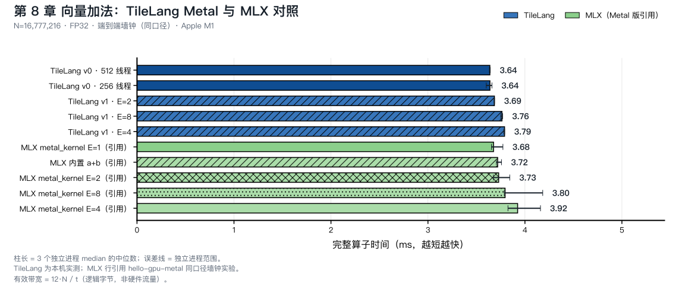

# 第8章 Element-Wise：逐元素算子

## 本章导读

> 算子实战的第一站仍然是最简单的 `C[i] = A[i] + B[i]`，但命题变成：**手里有了一个能跑通的正确基线后，如何系统性地判断下一步值得改什么？改动之后如何决定保留还是回退？**
>
> 本章沿 **TileLang（`target="metal"`）** 与 **MLX（引用 hello-gpu-metal 同口径墙钟）** 两条路线展开。TileLang 路线在本机 Apple M1 上实测端到端墙钟；MLX 路线的数字直接引用 hello-gpu-metal 的同 shape、同 seed、同 warmup/repeat 实验，不重跑。
>
> **计时口径提醒：** TileLang 的 Metal 后端不暴露 command buffer GPU 时间戳，本章统一用端到端墙钟（`wall-clock-full-operator`，含一次完整 kernel 调用 + `torch.mps.synchronize`）。它与 MLX 墙钟同口径、可直接比较；与 Metal 版 MSL 的 GPU 时间戳**不同口径**。

| 阅读路线 | 推荐起点 |
| ---- | ---- |
| 第一次接触 GPU 算子 | 先读 8.1–8.3 的公共基础，再在[实现节](#_8-4-实现向量加法)选标签 |
| 倾向 tile 级 DSL | 8.4 选 **TileLang** 标签，看 `T.Kernel` 网格与线程绑定 |
| 倾向数组抽象 | 8.4 选 **MLX** 标签，看内置 `a+b` 与 `metal_kernel` |

## 8.1 逐元素算子的数据依赖

### 8.1.1 输出之间的独立性

向量加法的数学定义：

$$
C_i = A_i + B_i, \qquad 0 \le i \lt N
$$

计算 `C[3]` 只需读 `A[3]`、`B[3]` 并相加，不等待任何其他位置的结果。**不同输出之间互不依赖**，每个位置是一项独立任务。程序可以用索引公式安排分工：一个线程一个元素，或一个线程多个元素。

| 算子 | 单个输出 | 依赖 |
| ---- | ---- | ---- |
| Add | `Y[i] = A[i] + B[i]` | 仅同索引输入 |
| ReLU | `Y[i] = max(X[i], 0)` | 仅同索引输入 |
| Scale & Bias | `Y[i] = alpha * X[i] + beta` | 同索引输入 + 常量 |

共同点：计算一个输出不需要其他输出。**「输入输出形状一致」不等于逐元素**——归约（第 9 章）与 Softmax（第 10 章）形状也一致，但存在跨位置聚合。

### 8.1.2 TileLang 与 MLX 的实现视角

- **TileLang 采用「tile 网格 + 线程绑定」视角**：`T.Kernel(groups, threads=block)` 声明 threadgroup 网格，`T.get_thread_binding()` 取组内线程号，再用 `T.serial` 循环表达每线程工作量。lower 到 Metal 后就是显式的 thread 索引。
- **MLX 采用「数组主导」视角**：内置 `a + b` 由框架分块；`mx.fast.metal_kernel` 自定义 kernel 时回到显式线程下标与 `if (i < n)` 边界判断。

两者数学语义相同，差别在**谁决定分工**：TileLang 由你写索引公式，MLX 内置算子由框架决定。

## 8.2 固定数学语义与正确性标准

### 8.2.1 四元素示例

```text
A = [2, -1, 4, 3]
B = [7,  3, -1, 2]
C = [9,  2, 3, 5]
```

规模扩大到 16,777,216 个元素时数学不变，变的只是并发访存组织。

### 8.2.2 参考实现与检查条件

| 项目 | 固定方式 |
| ---- | ---- |
| 数学语义 | `C[i] = A[i] + B[i]`，FP32 |
| 输入 | `a[i]=((17*i+seed)%2048-1024)/1024`；`b[i]=((29*i+3*seed)%4096-2048)/2048` |
| 参考 | CPU 逐元素 FP32 加法（输入为 2 的负幂次整数倍，结果精确） |
| 边界 | 1, 3, 4, 5, 31, 32, 33, 255, 256, 257, 1027, 4099 与尾部 16,777,219 |
| 正确性 | 计时前后各检查一次；输出先填 NaN；全量 finite + `abs err <= 1e-6` |
| 计时 | 端到端墙钟：预热 10、测量 50；分配/输入生成/校验/首次编译在计时外 |

所有输入值都是 2 的负幂次的整数倍，FP32 加法精确，正确实现的最大绝对误差应为 **0**；判定阈值仍取 `1e-6`。

### 8.2.3 非整除长度的边界

`N=1027`、每 threadgroup 256 线程时最后一组只剩 3 个有效元素。TileLang 版在循环内用 `if idx < n` 保护读写；MLX 自定义 kernel 用 `if (i < n)`，越界读 0、跳过写回。**读与写都要防护**。本章边界脚本共 65 个用例（13 个长度 × 5 个配置），全部 `OK`、`max_abs_error=0`。

## 8.3 建立成本模型和瓶颈假设

### 8.3.1 逻辑计算量与数据量

| 动作 | 数量 | 逻辑字节 |
| ---- | ----: | ----: |
| 读 `A[i]` | 1 FP32 | 4 |
| 读 `B[i]` | 1 FP32 | 4 |
| 加法 | 1 FLOP | — |
| 写 `C[i]` | 1 FP32 | 4 |
| 合计 | | 12 Byte + 1 FLOP |

$$
AI_{logical} = \frac{1\ \text{FLOP}}{12\ \text{Byte}} \approx 0.0833\ \text{FLOP/Byte}
$$

这是**逻辑**算术强度，不是总线实测流量。假设：每 12 字节只做 1 次浮点加法，算子受限于内存供给而非算力；优化优先看访存排布与启动/分工开销。统一内存省去显式拷贝，但**不消除 GPU 内存流量**。

### 8.3.2 有效带宽怎样算

$$
BW_{effective} = \frac{3 \times N \times 4\ \text{Byte}}{t}
$$

`t` 必须来自同一计时口径。本章 TileLang 与 MLX 都是墙钟，可以代入同一公式比较；但它不等于内存控制器实际传输字节数。

## 8.4 实现向量加法

先区分三件事：

| 方法 | 回答的问题 | 何时执行 |
| --- | --- | --- |
| 正确性检查 | 输出仍符合加法语义？尾部漏写/越界？ | 每次改动后，先检查再计时 |
| Benchmark | 相同条件下更快吗？收益超过进程范围吗？ | 每轮改动都做 |
| Profiling | 哪项额外证据能解释现象？ | 有具体问题且工具能回答时 |

**固定比较条件。** Apple M1（applegpu_g13g）、macOS 27.0、Python 3.12.11、TileLang 0.1.15、NumPy 2.5.4、PyTorch 2.15.0。`N=16,777,216`、FP32、`seed=20260920`；每配置 3 个独立进程、配置顺序轮换；柱长为三进程 median 的中位数，误差线为三 median 的最小—最大范围。

<ImplementationTabs id="ch8-implementations">

<template #tilelang>

### 8.4.1 TileLang 基线：一个线程一个元素

起点是最自然的映射：相邻线程访问相邻元素，无跨元素依赖，不需要 threadgroup 内存或同步。

```python
with T.Kernel(T.ceildiv(n, block * elems), threads=block) as bx:
    tid = T.get_thread_binding()
    for j in T.serial(elems):
        idx = bx * block * elems + j * block + tid
        if idx < n:
            C[idx] = A[idx] + B[idx]
```

`elems=1` 时退化为一线程一元素；`N=16,777,216`、`block=256` 时共 65,536 个 threadgroup。`if idx < n` 保留尾部保护，使同一份 kernel 能处理非整除长度。

<details>
<summary>完整源码：code/part2-kernels/chapter8/vector_add_tilelang.py</summary>

<<< @/../code/part2-kernels/chapter8/vector_add_tilelang.py{python}

</details>

主机程序负责 MPS 张量准备、NaN 预填、预热与墙钟采样：

<details>
<summary>共用输入与校验：code/part2-kernels/chapter8/vector_add_common.py</summary>

<<< @/../code/part2-kernels/chapter8/vector_add_common.py{python}

</details>

**运行与校验**

```bash
.venv/bin/python code/part2-kernels/chapter8/vector_add_tilelang.py \
  --version v0 --block 256 --elements 1 \
  --size 16777216 --warmup 10 --repeat 50 --seed 20260920
```

<details>
<summary>运行输出：tilelang-v0-b256，第 1 个独立进程</summary>

<<< @/../code/part2-kernels/chapter8/evidence/metal-rounds/logs/n16777216-tilelang-v0-b256-p1.log{text}

</details>

先核对 `shape=16777216`、`threadgroup=256`、`threads=16777216` 与三个 `OK`，再看 `median_ms`。单进程 `median_ms=3.601042`；三个独立进程的中位数为 **3.601042、3.659791、3.639062 ms**，图中取三者中位数 **3.639062 ms**，范围 **3.601042–3.659791 ms**。较慢的一次也保留。

### 8.4.2 threadgroup 宽度：256 → 512

只改 `--block`，其余不变。假设：更宽的 threadgroup 减少 threadgroup 数、摊薄调度开销；但 M1 的 SIMD-group 为 32 lane，512 线程 = 16 个 SIMD-group，占用率收益未必存在。

实测 **3.638437 ms**（范围 3.633521–3.641812），与 256 的 3.639062 ms 差异 0.0006 ms，**远小于进程范围**（256 的范围宽 0.059 ms）。结论：尚未观察到稳定差异，保留 256 作为基线（更小的 threadgroup 对尾部更友好）。

### 8.4.3 每线程元素数：E=2 / 4 / 8

让一个线程串行处理 E 个元素，threadgroup 数降为 `N/(256·E)`。假设：减少 threadgroup 数与启动开销、提高每线程访存局部性。

| 配置 | 中位数 (ms) | 进程范围 (ms) | 有效带宽 (GB/s) |
| --- | ---: | --- | ---: |
| v1 · E=2 | 3.685563 | 3.680667–3.687062 | 54.63 |
| v1 · E=4 | 3.790042 | 3.781001–3.791270 | 53.12 |
| v1 · E=8 | 3.763230 | 3.749646–3.769999 | 53.50 |

三个 E 都**没有**比 E=1 快：E=4 比基线慢约 4.2%，且超出基线进程范围。串行循环增加了每线程的指令数与寄存器压力，而访存本来就是瓶颈，减少 threadgroup 数并没有换来带宽。决策：**撤回 E>1**，保留 E=1。

### 8.4.4 TileLang 路线的实验决策

| 改动 | 相对基线 | 决策 |
| --- | --- | --- |
| block 256 → 512 | −0.02%（范围内） | 不保留，差异不显著 |
| E=1 → 2 | +1.3% | 撤回 |
| E=1 → 4 | +4.2% | 撤回 |
| E=1 → 8 | +3.4% | 撤回 |

基线 v0·256 即本路线最优；本章没有「优化成功」的改动，这本身就是结论：**访存受限的逐元素算子，分工扫描的收益空间很小**。

</template>

<template #mlx>

### 8.4.5 MLX 基线：内置数组加法

MLX 路线的最自然基线是 `a + b`：框架决定分块与边界，用户不写线程索引。

<details>
<summary>完整参考源码：code/part2-kernels/chapter8/vector_add_mlx.py</summary>

<<< @/../code/part2-kernels/chapter8/vector_add_mlx.py{python}

</details>

> 本仓库 `.venv` 未安装 mlx，此文件仅作路线参考与可复现源码保留；**表中数字引用 hello-gpu-metal 的同口径墙钟实验**（`provenance=cited-hello-gpu-metal`），不重跑。

运行（安装 mlx 后）：

```bash
.venv/bin/python code/part2-kernels/chapter8/vector_add_mlx.py \
  --version m0 --size 16777216 --warmup 10 --repeat 50 --seed 20260920
```

引用结果：`mlx-m0` 中位数 **3.718750 ms**（范围 3.705417–3.758312），有效带宽 54.14 GB/s。

### 8.4.6 自定义 metal_kernel：每线程元素数扫描

`mx.fast.metal_kernel` 回到显式线程下标：第 `group` 个 threadgroup 负责 `[group*E*tg, (group+1)*E*tg)`，第 `j` 轮相邻线程读相邻地址，`if (i < n)` 保护尾部。

| 配置 | 中位数 (ms) | 进程范围 (ms) | 有效带宽 (GB/s) |
| --- | ---: | --- | ---: |
| m1 · E=1 | 3.676229 | 3.654833–3.773000 | 54.76 |
| m1 · E=2 | 3.729167 | 3.674938–3.843312 | 53.99 |
| m1 · E=4 | 3.924750 | 3.825021–4.160271 | 51.30 |
| m1 · E=8 | 3.795375 | 3.787250–4.183521 | 53.05 |

与 TileLang 路线同向：E=4 最慢（+6.8% 相对 m1·E=1），E=2/8 无稳定收益。**两条独立路线得到同一结论**，增强了「分工扫描收益有限」这一判断的可信度。

### 8.4.7 MLX 路线的实验决策

保留内置 `a+b` 作为基线（3.718750 ms）；自定义 kernel 的 E=1（3.676229 ms）略快但进程范围重叠（m0 范围 3.705–3.758 与 m1-e1 范围 3.655–3.773 相交），不宣称稳定收益。E>1 全部撤回。

</template>

</ImplementationTabs>

## 8.5 正确性、基准测试与性能分析

### 8.5.1 从问题到字段

每个进程输出一行 `RESULT`，关键字段：

| 字段 | 含义 |
| --- | --- |
| `correct` / `precheck` / `postcheck` | 计时前后全量 finite + abs err 检查 |
| `median_ms` | 50 次墙钟样本的中位数 |
| `scope` | `wall-clock-full-operator` |
| `threads` | 总线程数 = groups × block |
| `effective_bandwidth_gbs` | 12·N / t，逻辑字节换算 |

三进程汇总见 `evidence/metal-rounds/summary/process-summary.csv`（每进程 median/min/max）与 `summary.csv`（跨进程中位数与范围）。

### 8.5.2 边界正确性结果

`validate_tilelang.py` 独立于计时运行：13 个长度 × 5 个配置 = **65 个用例**，含尾部 `N=16,777,219`（非 256 整除）。全部 `OK`，`max_abs_error=0`。归档于 `evidence/metal-rounds/boundary.json`。

### 8.5.3 Instruments 与 Xcode GPU Capture：官方工具，未在本机实测

Instruments 的 Metal System Trace 与 Xcode 的 GPU Capture 能给出逐 dispatch 时间戳、occupancy 与计数器，是解释「为什么 E=4 变慢」的官方途径。**本仓库未在本机运行它们**，因此本章不给出任何 trace 数字；墙钟 + 进程范围是唯一证据。若你要补 profiling，先确认 TileLang Metal 后端能否被 Xcode 捕获（它经 MPS 提交，capture 粒度与原生 MSL 不同）。

## 8.6 两路线比较与验证

### 8.6.1 主输入汇总

::: figure fig-ch8-round-summary


<details class="figure-zoom">
<summary>放大图表（可横向滚动）</summary>
<div class="figure-scroll" tabindex="0" role="region" aria-label="第 8 章逐轮比较放大图，可横向滚动">



</div>
</details>

N=16,777,216 · FP32 · 端到端墙钟。柱长为三个独立进程 median 的中位数，误差线为进程范围；TileLang 为本机实测，MLX 行引用 hello-gpu-metal 同口径实验。
:::

@fig-ch8-round-summary 中最快的 TileLang 配置（v0·512，3.638437 ms）与最快的 MLX 配置（m1·E=1，3.676229 ms）相差 1.0%，**两条路线在本算子上打平**；这与「访存受限、分工收益小」的成本模型一致。

| 路线 | 最快配置 | 中位数 (ms) | 有效带宽 (GB/s) |
| --- | --- | ---: | ---: |
| TileLang | v0 · 512 线程 | 3.638437 | 55.33 |
| MLX（引用） | m1 · E=1 | 3.676229 | 54.76 |

### 8.6.2 其他规模验证

边界脚本覆盖 1 → 16,777,219 的 13 个长度；主实验只测 N=16,777,216。小 N 下启动开销占比上升，墙钟口径会放大 TileLang 的 JIT 提交开销，**不要**把大 N 的结论外推到小 N。

### 8.6.3 尾部正确性

`N=16,777,219 = 65,536×256 + 3`：最后一个 threadgroup 只有 3 个有效元素。E=1 与 E=8 的索引公式不同，尾部 guard 都必须覆盖读写；65 个用例全过说明两种映射的尾部都正确。

## 8.7 负面结果、边界与下一步

**负面结果。**
1. E=2/4/8 全部不优于 E=1（TileLang 与 MLX 同向）。串行循环的指令开销超过 threadgroup 数减少的收益。
2. block 512 与 256 无稳定差异；不要为「看起来更宽」而改配置。
3. 本章没有成功优化。逐元素算子的优化空间在访存排布（第 8 章 Metal 版的地址排列实验），而 TileLang Metal 后端当前不暴露 float4 向量化加载的 tile 原语，**该方向在本路线不可测**，如实记录为边界。

**TileLang Metal 限制（实测）。**
- 无 GPU 时间戳接口 → 只能墙钟；与 MSL 时间戳不可混比。
- `T.Parallel` 之外的逐元素循环需手写 `T.serial` + 线程绑定；向量化加载（float4）无对应 tile 原语。
- threadgroup 线程数上限受 Metal 设备限制（M1 每 threadgroup 最大 1024 线程）；本章 512 已接近 SIMD-group 占用拐点。

**下一步。** 第 9 章把「独立输出」换成「跨线程聚合」，看归约如何引入同步与两阶段合并。

## 8.8 复现与练习

### 8.8.1 复现逐轮实验

```bash
.venv/bin/python code/part2-kernels/chapter8/run_rounds.py \
  --output code/part2-kernels/chapter8/evidence/my-run
```

`--output` 必须是**尚不存在**的目录。主阶段先跑 65 个边界用例，再按轮换顺序跑 5 个配置 × 3 个独立进程。只重绘图（不重跑）：

```bash
.venv/bin/python code/part2-kernels/chapter8/plot_rounds.py \
  --summary code/part2-kernels/chapter8/evidence/metal-rounds/summary/summary.csv \
  --out docs/part2-kernels/chapter8/images/round-summary
```

### 8.8.2 证据归档

`code/part2-kernels/chapter8/evidence/metal-rounds/`：`manifest.json`（环境、源码 sha256、执行顺序）、`boundary.json`、`logs/`、`samples/`、`summary/`。MLX 引用行见 `chapter8/mlx_reference.json`。

### 8.8.3 练习

1. 手算 N=16,777,216、block=256、E=4 时的 threadgroup 数与总线程数，并解释为什么总线程数变为 4,194,304。
2. 用 `summary.csv` 的 `median_ms` 手算 v0·256 的有效带宽，核对 55.32 GB/s。
3. 把 `--block` 改成 1024 重跑一轮，判断收益是否超过进程范围；若变慢，写出你的归因假设。