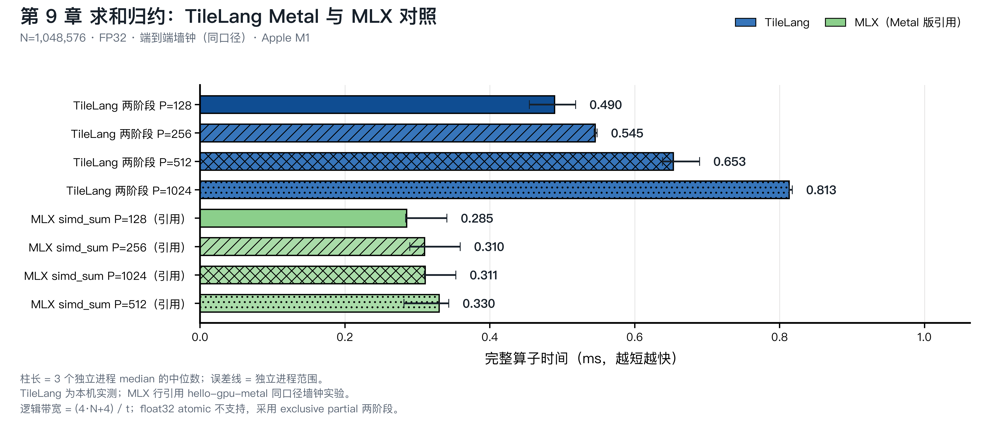

# 第9章 Reduction：求和归约

## 本章导读

> 第 8 章的输出互不依赖；本章的**单个输出需要全部输入**：$Y = \sum_{i} X_i$。并行归约必须回答两个问题：线程怎样合并局部结果？跨 threadgroup 的结果怎样汇总？
>
> TileLang Metal 后端**没有 float32 `atomic_add`、没有 `simd_sum`/`tl.reduce`**，因此本章采用与 Metal 版 MLX 同结构的 **exclusive partial 两阶段**：P 个 threadgroup 各做 grid-stride 累加得 `partial[P]`，再由 1 个 1024 线程的 threadgroup 合并成标量。
>
> 计时仍为端到端墙钟（两次 kernel 调用 + 同步）；MLX 行引用 hello-gpu-metal 同口径实验。

## 9.1 归约算子的数据依赖

### 9.1.1 一个输出依赖全部输入

$$
Y = \sum_{i=0}^{N-1} X_i
$$

与逐元素相反：**任何部分和都依赖一段输入**，最终输出依赖所有部分和。依赖图是一棵树：叶子是输入，根是标量。并行化的关键是**树的形状**——先组内合并、再跨组合并，而不是让一个线程串行加完 N 个数。

### 9.1.2 结合律与浮点顺序

加法满足结合律，但 **FP32 不满足结合律**：不同合并顺序产生不同舍入。本章主输入 `random` 是 1/32 的整数倍且部分和远小于 $2^{19}$，任何顺序都精确，因此可以与 FP64 参考**严格相等**；`uniform` 输入则用 Higham 误差上界作容差。这决定了「正确性」在本章是**逐输入类型**定义的。

### 9.1.3 两阶段结构的必要性

Metal 无 float32 原子加，跨 threadgroup 不能直接 `atomic_add` 到一个标量。可选路线：
1. **exclusive partial**：每 threadgroup 写自己的 `partial[bx]`（无竞争），第二阶段合并。本章采用。
2. int32 原子加 + 定点缩放：改变数学语义（引入量化误差），本章不采用。

## 9.2 固定数学语义与正确性标准

### 9.2.1 四元素示例

```text
X = [1, 2, 3, 4]  ->  Y = 10
```

P=2、每 threadgroup 2 线程时：partial = [1+2, 3+4] = [3, 7]，final = 3+7 = 10。

### 9.2.2 参考实现与检查条件

| 项目 | 固定方式 |
| ---- | ---- |
| 语义 | FP32 求和，参考为 FP64 `np.sum` |
| 输入 | `ones` / `weighted` / `random`（1/32 整数倍，精确）与 `uniform`（一般浮点） |
| 主输入 | `random`，N=1,048,576，seed=20260920 |
| 容差 | 精确输入：`actual == expected`；uniform：Higham 上界 $\frac{k}{1-k}\sum|X_i|$，$k = 32 \cdot 2^{-24}$ |
| 边界 | 1, 3, 31, 32, 33, 255, 256, 257, 1027, 4099, 262147 × P∈{128,256,1024} × 2 输入 = 66 用例 |
| 计时 | 墙钟：预热 5、测量 10；两次 kernel 调用都计入 |

### 9.2.3 补零与尾部

`stride = P × 256`。输入补零到 stride 的整数倍后**无条件读取**（越界补零位置贡献 0）。这不是偷懒：Metal 后端在 `T.serial` 循环内加 `if` guard 会触发 LayoutInference 缺陷（见 9.7），补零是回避该缺陷的等价语义做法。partial 缓冲区同样补零到 1024 的整数倍供 final 无条件读取。

## 9.3 建立成本模型和瓶颈假设

### 9.3.1 逻辑字节与算术强度

| 阶段 | 读 | 写 |
| ---- | ----: | ----: |
| partial | 4N | 4P |
| final | 4P | 4 |
| 合计 | 4N + 4P | 4P + 4 |

$$
AI_{logical} = \frac{N\ \text{FLOP}}{4N + 8P + 4\ \text{Byte}} \approx 0.25\ \text{FLOP/Byte}
$$

仍属访存受限，但比逐元素高 3 倍；且**第二阶段是纯延迟**：1024 线程串行合并 P 个 partial，thread0 的 serial 循环是 O(P) 指令。

### 9.3.2 逻辑带宽怎样算

$$
BW_{logical} = \frac{4N + 4}{t}
$$

只计主输入读与标量写（partial 是中间量，不计入「有效」带宽，但计入成本模型的总流量）。P 增大时 partial 流量 8P 线性增长，这是 P 扫描的理论预期：**P 越大越慢**。

## 9.4 实现求和归约

**固定比较条件。** Apple M1、macOS 27.0、TileLang 0.1.15；N=1,048,576、FP32、`random`、seed=20260920；预热 5、测量 10；3 个独立进程轮换。

<ImplementationTabs id="ch9-implementations">

<template #tilelang>

### 9.4.1 TileLang 基线：P=256 的两阶段

第一阶段每 threadgroup 256 线程做 grid-stride 累加，写入 shared 后由 thread0 serial 合并：

```python
with T.Kernel(programs, threads=threads) as bx:
    tid = T.get_thread_binding()
    local = T.alloc_fragment((1,), T.float32)
    T.clear(local)
    for j in T.serial(n // stride):
        local[0] = local[0] + A[bx * threads + tid + j * stride]
    s = T.alloc_shared((threads,), T.float32)
    s[tid] = local[0]
    T.sync_threads()
    if tid == 0:
        acc = T.alloc_fragment((1,), T.float32)
        T.clear(acc)
        for i in T.serial(threads):
            acc[0] = acc[0] + s[i]
        partials[bx] = acc[0]
```

注意 `if tid == 0` 内的 **serial 合并 256 个 shared 值**：Metal 无 `simd_sum`，树形归约又触发 LayoutInference 缺陷，只能串行。这是本路线的结构性开销。

<details>
<summary>完整源码：code/part2-kernels/chapter9/reduction_tilelang.py</summary>

<<< @/../code/part2-kernels/chapter9/reduction_tilelang.py{python}

</details>

<details>
<summary>共用输入与误差上界：code/part2-kernels/chapter9/reduction_common.py</summary>

<<< @/../code/part2-kernels/chapter9/reduction_common.py{python}

</details>

**运行与校验**

```bash
.venv/bin/python code/part2-kernels/chapter9/reduction_tilelang.py \
  --programs 256 --size 1048576 --input random \
  --warmup 5 --repeat 10 --seed 20260920
```

<details>
<summary>运行输出：tilelang-p256，第 1 个独立进程</summary>

<<< @/../code/part2-kernels/chapter9/evidence/metal-rounds/logs/n1048576-tilelang-p256-p1.log{text}

</details>

三进程中位数 **0.548124、0.543978、0.545438 ms**，图中取 **0.545438 ms**，范围 **0.543978–0.548124 ms**。

### 9.4.2 threadgroup 数扫描：P=128 / 512 / 1024

只改 `--programs`。假设：P 越小，partial 流量与 final 的 serial 合并越短；但 P 太小会让第一阶段每线程串行轮数 `N/(P·256)` 变长。

| 配置 | 中位数 (ms) | 进程范围 (ms) | 逻辑带宽 (GB/s) |
| --- | ---: | --- | ---: |
| P=128 | 0.489563 | 0.454584–0.518521 | 8.57 |
| P=256 | 0.545438 | 0.543978–0.548124 | 7.69 |
| P=512 | 0.653271 | 0.638354–0.689479 | 6.42 |
| P=1024 | 0.813333 | 0.813020–0.817562 | 5.16 |

**单调变慢**，与成本模型一致：P 翻倍 → partial 流量翻倍 + final serial 合并翻倍。P=128 相对 P=1024 快 40%。决策：**保留 P=128**。

### 9.4.3 为什么不用树形 shared 归约

尝试过「跨步 shared 树形归约」（log2(256)=8 轮代替 256 次 serial）：Metal 后端在并行跨步 shared 访问上触发 LayoutInference 缺陷，编译失败或结果错误。**回避而非修复**：改用 thread0 serial 合并，正确性优先。该负面结果写入 9.7。

### 9.4.4 TileLang 路线的实验决策

| 改动 | 相对 P=256 | 决策 |
| --- | --- | --- |
| P=128 | −10.2% | 保留 |
| P=512 | +19.8% | 撤回 |
| P=1024 | +49.1% | 撤回 |
| 树形 shared 归约 | 编译/正确性失败 | 回避，记录缺陷 |

</template>

<template #mlx>

### 9.4.5 MLX 基线：simd_sum 两阶段

MLX 路线可以用 Metal 的 `simd_sum`（32 lane 硬件归约）+ 两级 simd 合并，避免 thread0 serial：

<details>
<summary>完整参考源码：code/part2-kernels/chapter9/reduction_mlx.py</summary>

<<< @/../code/part2-kernels/chapter9/reduction_mlx.py{python}

</details>

> 数字引用 hello-gpu-metal 同口径墙钟实验（`provenance=cited-hello-gpu-metal`）；本仓库 `.venv` 未安装 mlx。

```bash
.venv/bin/python code/part2-kernels/chapter9/reduction_mlx.py \
  --programs 256 --size 1048576 --warmup 5 --repeat 10 --seed 20260920
```

### 9.4.6 MLX 的 P 扫描

| 配置 | 中位数 (ms) | 进程范围 (ms) | 逻辑带宽 (GB/s) |
| --- | ---: | --- | ---: |
| P=128 | 0.285208 | 0.283958–0.340854 | 14.71 |
| P=256 | 0.309979 | 0.289708–0.359125 | 13.53 |
| P=512 | 0.330230 | 0.281604–0.343354 | 12.70 |
| P=1024 | 0.310792 | 0.309604–0.353104 | 13.50 |

同样 P 越小越快，但 **P=1024 出现回弹**（0.3108 < 0.3302）：simd_sum 的合并是 O(log) 硬件操作，final 的 serial 开销不存在，P 增大只增加 partial 流量，拐点比 TileLang 晚。

### 9.4.7 MLX 路线的实验决策

保留 P=128（0.285208 ms）。与 TileLang 同配置比：0.285208 vs 0.489563，**MLX 快 1.72 倍**——差距主要来自 `simd_sum` 对 thread0 serial 合并的替代，而非第一阶段访存。

</template>

</ImplementationTabs>

## 9.5 正确性、基准测试与性能分析

### 9.5.1 从问题到字段

`RESULT` 行含 `input=random`、`max_abs_error=0`（精确输入）、`logical_bandwidth_gbs`。注意 `block` 字段在本章表示 **P（threadgroup 数）**，`threads = P×256`。

### 9.5.2 边界正确性结果

66 个用例（11 长度 × 3 个 P × 2 输入类型）全部 `OK`。`uniform` 用例的误差均小于 Higham 上界；`random` 用例误差为 0。归档 `evidence/metal-rounds/boundary.json`。

### 9.5.3 Instruments 与 Xcode GPU Capture：官方工具，未在本机实测

要验证「final 的 serial 合并是主导开销」，官方途径是 Xcode GPU Capture 看两次 dispatch 的占比与 thread0 的指令数。**未在本机实测**；本章只用墙钟差值（P 扫描的单调性）作间接证据。

## 9.6 两路线比较与验证

### 9.6.1 主输入汇总

::: figure fig-ch9-round-summary


N=1,048,576 · FP32 · 端到端墙钟。柱长为三进程 median 的中位数，误差线为进程范围；TileLang 为本机实测，MLX 行引用 hello-gpu-metal 同口径实验。
:::

@fig-ch9-round-summary 中两条路线的 P 扫描形状不同：TileLang 单调、MLX 在 P=1024 回弹。同 P 下 MLX 快 1.6–1.7 倍，归因于硬件 simd 归约。

| 路线 | 最快配置 | 中位数 (ms) | 逻辑带宽 (GB/s) |
| --- | --- | ---: | ---: |
| TileLang | P=128 | 0.489563 | 8.57 |
| MLX（引用） | P=128 | 0.285208 | 14.71 |

### 9.6.2 与第 8 章的口径衔接

第 8 章预热 10/测量 50，本章预热 5/测量 10（归约单次更短、样本噪声更大）。**跨章比较只看各自相对改进**，不直接比绝对 ms。

### 9.6.3 其他规模验证

边界覆盖 N=1 → 262,147。N=1 时 stride=P×256 远大于 N，补零后几乎全读 0，仍正确——验证了补零语义。

### 9.6.3 尾部正确性

N=262,147 非 256 整除：补零到 stride 倍数后尾部贡献 0，与「只加有效元素」等价。66 用例全过。

## 9.7 负面结果、边界与下一步

**负面结果。**
1. P=512/1024 显著变慢（+19.8%/+49.1%），与 partial 流量 + serial 合并的成本模型一致。
2. 树形 shared 归约在 Metal 后端触发 LayoutInference 缺陷，**不可用**；thread0 serial 合并是当前唯一正确写法。
3. `T.serial` 循环内的 `if` guard 同样触发该缺陷 → 必须补零 + 无条件读取。这限制了「不补零、带 guard」的更省内存写法。

**TileLang Metal 限制（实测）。**
- `T.reduce_sum` 未注册 metal 实现；float32 `T.atomic_add` 不支持（仅 int32/uint32）。
- 无 `simd_sum`/`tl.reduce` → 组内归约只能 thread0 serial，O(threads) 指令。
- 并行跨步 shared 树形归约、serial 循环内 guard 均触发 LayoutInference 缺陷。
- threadgroup 上限 1024 线程；final 用满 1024。

**下一步。** 第 10 章把「一次归约」变成「行内三次归约 + 逐元素写回」，看 Softmax 的稳定性与融合。

## 9.8 复现与练习

### 9.8.1 复现逐轮实验

```bash
.venv/bin/python code/part2-kernels/chapter9/run_rounds.py \
  --output code/part2-kernels/chapter9/evidence/my-run
```

只重绘图：

```bash
.venv/bin/python code/part2-kernels/chapter9/plot_rounds.py \
  --summary code/part2-kernels/chapter9/evidence/metal-rounds/summary/summary.csv \
  --out docs/part2-kernels/chapter9/images/round-summary
```

### 9.8.2 证据归档

`code/part2-kernels/chapter9/evidence/metal-rounds/`；MLX 引用行见 `chapter9/mlx_reference.json`。

### 9.8.3 练习

1. 手算 P=128 时第一阶段每线程串行轮数 `N/(P·256)`，并解释 P=1024 时该值变为多少。
2. 用 Higham 上界公式估算 `uniform`、N=1,048,576、depth=32 的容差量级。
3. 把 final 的 threads 从 1024 改成 256（需补零到 256 倍数），预测并实测 P=128 的变化；注意这同时改变补零长度。